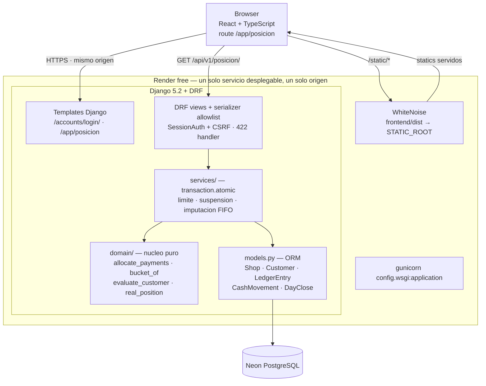
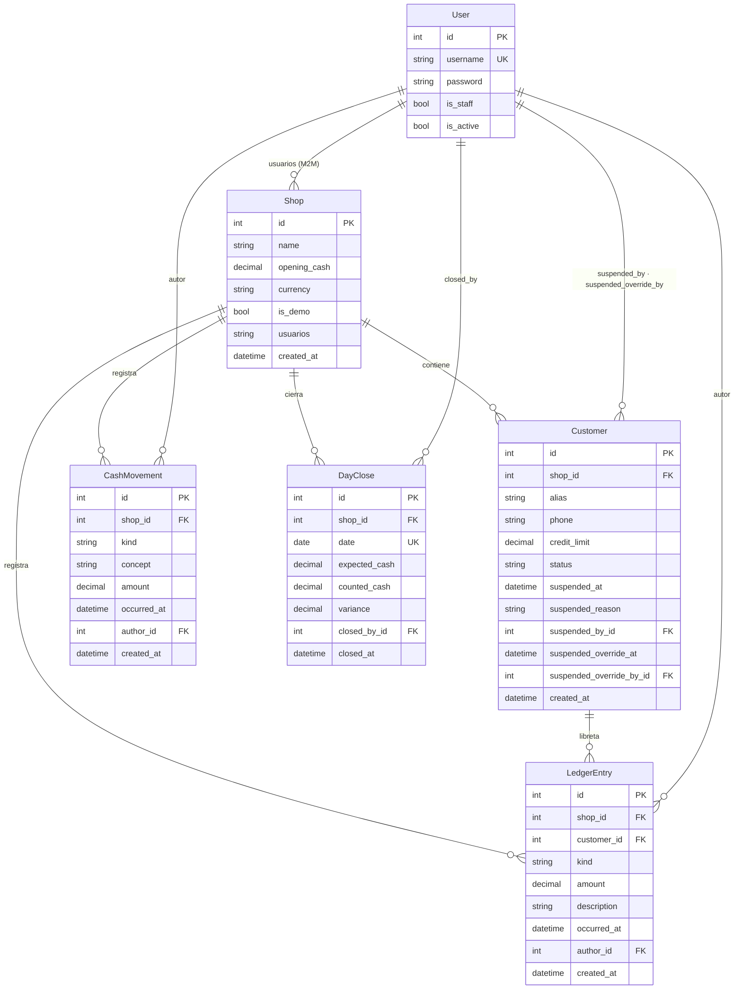
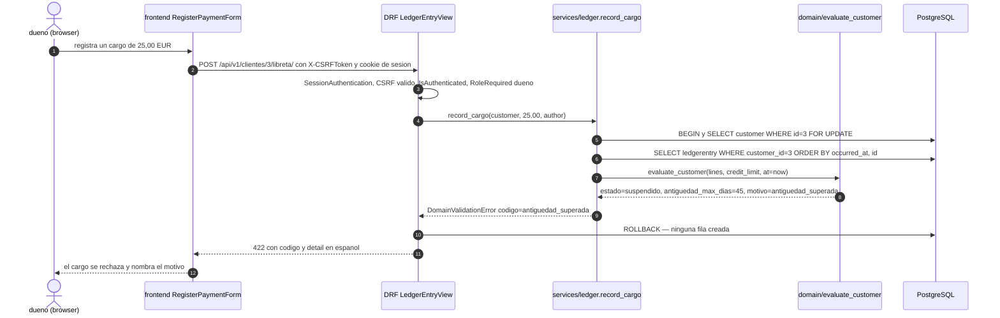
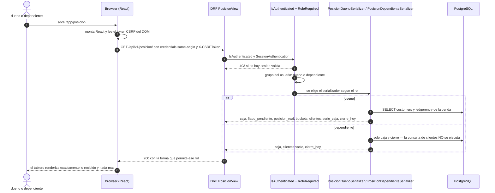

# Design: `fiado` — La libreta y la caja (Tienda de barrio)

**Change:** `tienda-barrio` · **Phase:** SDD design · **Artifact store:** OpenSpec + Engram mirror
**Sources of truth:** `proposal.md` (scope) · `specs/{credit-book,cash-position,role-access-control,position-board}/spec.md` (behaviour) · `spec-traceability.md` (coverage) · `submission-notes.md` §5/§8/§9/§10 (technical approach, permission matrix, data model, capabilities)
**Language contract:** prose in English; **every domain identifier, field name, API field and diagram label stays in Spanish** (`fiado`, `cargo`, `pago`, `nota de crédito`, `caja`, `dependiente`, `dueño`, `libreta`, `posición real`, `antiguedad_max_dias`, `suspended_reason`, `vigente`/`envejecido`/`viejo`/`cronico`) because these are the code identifiers and the diagram labels are pasted verbatim into the memoria.

---

## 1. Overview and architecture

### 1.1 Technical approach

One deployable service. Django 5.2 renders the login and the React mount point; Django REST Framework serves `/api/v1/*` under the **same origin and the same session cookie**; the domain rules live in an **ORM-free pure module** that both the API and the unit tests call; React is compiled by Vite into `frontend/dist` and served by WhiteNoise from `STATIC_ROOT`; Neon holds the only persistent state.

The three ideas the whole design hangs on:

1. **Nothing derived is stored.** `caja`, `fiado pendiente`, `posicion_real`, the ageing buckets, `antiguedad_max_dias` and the suspension status are computed from the append-only ledger on every read. There is no balance column, so no balance can drift.
2. **The rules are pure.** `allocate_payments`, `bucket_of`, `evaluate_customer`, `real_position` (plus `outstanding` and `cash_at`) take plain values and return plain values. That is what makes the `unit` verification level in `spec-traceability.md` reachable without a database.
3. **The server decides the shape of every payload.** A `dependiente` asking for `/api/v1/posicion/` receives a payload built by a *different serializer class* — one whose field allowlist simply does not contain `fiado_pendiente`, `posicion_real`, the buckets or any customer field. The allowlist, not the view, is what makes "no alias in ANY JSON path" a structural property.

### 1.2 The two open decisions, resolved

**Decision A — the database-level backstop (CB-07, CB-09).**

The honest answer: a SQL `CHECK` constraint sees **one row**, never an aggregate and never another table's rows. Therefore the database can enforce *per-row invariants only*, and the cross-row business rules **cannot** live in a constraint.

| Invariant | Enforced by | Why |
|---|---|---|
| `LedgerEntry.amount > 0` | **DB `CheckConstraint`** | per-row, immutable expression ✓ |
| `LedgerEntry.kind ∈ {cargo, pago, nota_credito}` | **DB `CheckConstraint`** | per-row ✓ |
| `CashMovement.amount > 0`, `kind ∈ {entrada, salida}` | **DB `CheckConstraint`** | per-row ✓ |
| `Customer.credit_limit ≥ 0` | **DB `CheckConstraint`** | per-row ✓ (NULL passes — `null` is the explicit «sin límite» state) |
| `LedgerEntry.occurred_at ≤ created_at` | **DB `CheckConstraint`** | per-row, and `created_at` is the insert instant → a future-dated entry cannot be stored even if the form is bypassed ✓ |
| `DayClose.(shop, date)` unique | **DB `UniqueConstraint`** | per-row uniqueness ✓ |
| **`outstanding > credit_limit`** | **server, inside `transaction.atomic()`** | cross-row aggregate — a `CHECK` **cannot** express it |
| **customer is `suspendido`** | **server, inside `transaction.atomic()`** | cross-row aggregate — a `CHECK` **cannot** express it |
| **the client sends `occurred_at`** | **serializer → 422 `campo_no_admitido`** | the write API does not accept it; the server stamps `now()`. `now()` is not immutable, so a Postgres `CHECK` may not call it without an `IMMUTABLE` wrapper, which would freeze time — the `occurred_at ≤ created_at` constraint is the honest DB-level backstop |

So: the DB is a **safety net for the per-row invariants**, and the **transactional server-side check is the enforcement point for the cross-row rules**. The proposal's sentence «una `CheckConstraint` es la red de seguridad» (`submission-notes.md` §7, question 3) is therefore **overstated and must be corrected** to: *«la regla se evalúa en el servidor, dentro de la misma transacción del cargo, devuelve 422 y no crea asiento; la base de datos solo puede vigilar los invariantes por fila (importe positivo, tipo permitido, fecha no futura, fecha de cierre única)»*. **Flagged for correction** — it is a wording fix in `proposal.md` / `submission-notes.md`, not a design change. The spec wording in CB-07 («MUST be backed by a database-level `CheckConstraint`») is satisfied by the `occurred_at ≤ created_at` + `amount > 0` + `kind` constraints backing the refusal at row level, with the suspension decision itself made transactionally; the design states this explicitly rather than pretending a constraint can see the aggregate.

**Decision B — HTTP 422 (CB-07, CB-09, F2-AC1, F4-AC2).**

DRF answers `400` for a `ValidationError` by default. The status is set by **one mechanism, in one file**:

```
backend/tienda/api/exceptions.py
  class DomainValidationError(ValidationError):     # rest_framework.exceptions.ValidationError
      """Domain-rule violation. Carries a machine code + a Spanish message."""
  def exception_handler(exc, context):
      if isinstance(exc, ValidationError):
          return Response({"codigo": ..., "detail": ...}, status=422)
      return drf_exception_handler(exc, context)     # ParseError → 400, Http404 → 404, …
```

wired in `config/settings.py` via `REST_FRAMEWORK["EXCEPTION_HANDLER"] = "tienda.api.exceptions.exception_handler"`.

- **422** = every *validation* failure: a domain rule (`limite_superado`, `antiguedad_superada`, `importe_no_positivo`, `campo_no_admitido`) **and** a serializer field error. Rationale: CB-09 lists field-level invariants (`amount > 0`, allowed `kind`) and demands 422 for them, and the write API must reject an attempt to set `occurred_at`, so 400 must not be reachable through those fields.
- **400** survives only for a **malformed request body** (`ParseError`: invalid JSON) — that is not a validation failure.
- **403** = role denial / CSRF failure. **404** = unknown id. **405** = wrong method on a known path — and note that `LedgerEntry` exposes **only** `GET` (read) and `POST` (append); there is no `PUT`/`PATCH`/`DELETE` route for the ledger at all.

The `detail` payload of a domain error is a **Spanish, human-readable** message plus a stable machine code, so the acceptance criterion «un error de validación que **nombra el límite**» (F2-AC1) is literally satisfied:

```json
{ "codigo": "limite_superado",
  "detail": "El cliente «Marta — panadería» tiene un límite de crédito de 20,00 € y un saldo pendiente de 25,00 €. El cargo no se ha registrado." }
```

Because the write surface is **JSON only** (no server-rendered CRUD forms), there is exactly one status-code contract. That is deliberate: a second, HTML form path would be a second place where 400 and 422 could diverge.

### 1.3 Architecture diagram



---

## 2. Repository structure

```
C:\proyectos\final\
├─ backend/
│  ├─ manage.py
│  ├─ requirements.txt                  # pinned, exact versions (RAC-08)
│  ├─ pytest.ini                        # DJANGO_SETTINGS_MODULE + markers unit/integration/e2e
│  ├─ .env.example                      # empty placeholders only, no values
│  ├─ config/
│  │  ├─ __init__.py
│  │  ├─ settings.py                    # env-driven; DEBUG default False
│  │  ├─ urls.py                        # /health/ · /accounts/ · /app/ · /api/v1/
│  │  ├─ wsgi.py                        # gunicorn entry point
│  │  └─ asgi.py
│  ├─ tienda/
│  │  ├─ __init__.py
│  │  ├─ apps.py
│  │  ├─ admin.py                       # owner-only admin
│  │  ├─ auth_views.py                  # LoginView que escribe shop_id en la sesion (§7.4)
│  │  ├─ models.py                      # Shop, Customer, LedgerEntry, CashMovement, DayClose
│  │  ├─ domain/                        # << NUCLEO PURO — sin ORM, sin Django
│  │  │  ├─ __init__.py
│  │  │  ├─ types.py                    # LedgerLine, CashLine, Bucket, EntryKind, Allocation, CustomerState
│  │  │  ├─ allocation.py               # allocate_payments  (FIFO)
│  │  │  ├─ ageing.py                   # bucket_of, age_in_days
│  │  │  ├─ evaluation.py               # evaluate_customer (suspension)
│  │  │  └─ position.py                 # outstanding, cash_at, real_position
│  │  ├─ services/                      # orchestration transaccional (ORM si)
│  │  │  ├─ __init__.py
│  │  │  ├─ customers.py                # crear cliente, cambiar limite, anular suspension
│  │  │  ├─ ledger.py                   # record_cargo, record_pago, record_nota_credito
│  │  │  ├─ cash.py                     # record_movement
│  │  │  ├─ close.py                    # close_day
│  │  │  └─ shop_context.py             # current_shop(request) — el ambito de los datos (§7.4)
│  │  ├─ api/
│  │  │  ├─ __init__.py
│  │  │  ├─ urls.py                     # DRF router, sin rutas de escritura de la libreta
│  │  │  ├─ views.py
│  │  │  ├─ serializers.py              # <-- allowlist por rol
│  │  │  ├─ permissions.py              # RoleRequired / IsDueno
│  │  │  ├─ exceptions.py               # DomainValidationError + exception_handler 422
│  │  │  └─ pagination.py               # no-op: la paginacion esta desactivada
│  │  ├─ migrations/0001_initial.py
│  │  ├─ management/commands/seed_demo.py
│  │  ├─ templates/
│  │  │  ├─ base.html
│  │  │  ├─ registration/login.html
│  │  │  └─ app/posicion.html           # mount point + token CSRF; sin cifras
│  │  └─ static/app/css/board.css
│  └─ tests/
│     ├─ conftest.py                    # fixtures compartidas + markers
│     ├─ unit/                          # sin base de datos (pytest-django la bloquea)
│     │  ├─ conftest.py
│     │  ├─ test_allocation.py          # FIFO, excedente, nota de credito
│     │  ├─ test_ageing.py              # bucket_of en los limites 7/8/30/31/90/91
│     │  ├─ test_evaluation.py          # suspension por antiguedad y por limite
│     │  ├─ test_position.py            # real_position, outstanding, cash_at
│     │  └─ test_domain_is_orm_free.py  # test arquitectonico: el nucleo no importa Django
│     ├─ integration/                   # Django test client + PostgreSQL
│     │  ├─ conftest.py
│     │  ├─ test_api_clientes.py
│     │  ├─ test_api_libreta.py
│     │  ├─ test_api_caja_cierre.py
│     │  ├─ test_api_posicion.py
│     │  ├─ test_roles.py               # matriz 2x9
│     │  ├─ test_security.py            # CSRF, PBKDF2, 403, sin fuga en ninguna ruta
│     │  ├─ test_constraints.py         # CHECK y UNIQUE reales en PostgreSQL
│     │  └─ test_seed_demo.py           # idempotencia PB-05
│     └─ e2e/
│        ├─ test_public_url.py          # httpx contra la URL publica
│        └─ test_board_browser.py       # Playwright: el tablero renderizado
├─ frontend/
│  ├─ package.json                      # scripts build/test; lockfile fijado
│  ├─ package-lock.json
│  ├─ vite.config.ts                    # build.outDir = dist
│  ├─ tsconfig.json
│  ├─ index.html
│  └─ src/
│     ├─ main.tsx
│     ├─ App.tsx
│     ├─ api/posicion.ts                # fetch same-origin + X-CSRFToken
│     ├─ hooks/usePosicion.ts           # carga inicial + polling de 20 s
│     ├─ types/posicion.ts              # PosicionPayload del dueno / del dependiente
│     ├─ components/
│     │  ├─ HeroEquation.tsx
│     │  ├─ RiskLadder.tsx
│     │  ├─ CustomerRow.tsx
│     │  ├─ AgeingRibbon.tsx
│     │  ├─ LedgerDrawer.tsx
│     │  ├─ PositionChart.tsx
│     │  ├─ CloseCard.tsx
│     │  └─ RegisterPaymentForm.tsx
│     └─ styles/board.css
├─ .github/workflows/keepalive.yml      # cron */8 min → /health/ + workflow_dispatch
├─ render.yaml                          # build command, start command, env vars
├─ .gitignore
└─ README.md                            # instalacion, env, pruebas, URL, credenciales demo
```

**Where the domain core lives:** `backend/tienda/domain/` — a Python package with **zero** Django imports. `backend/tienda/services/` is the only place where the pure core meets the ORM; the API views call the services, the services call the domain core and the ORM.

---

## 3. The domain core

**Module:** `backend/tienda/domain/` · **Rule: the package MUST NOT import Django models** — nor `django.db`, nor `tienda.models`, nor any ORM type. That rule is what makes the `unit` verification level possible, because a pure function needs no fixture, no transaction and no database. The rule is **enforced by a test**, not by convention: `tests/unit/test_domain_is_orm_free.py` parses the AST of every file in `tienda/domain/` and fails if it imports `django` or `tienda.models`.

### 3.1 Types (`domain/types.py`)

```python
from dataclasses import dataclass
from datetime import datetime
from decimal import Decimal
from enum import Enum

class EntryKind(str, Enum):
    CARGO = "cargo"
    PAGO = "pago"
    NOTA_CREDITO = "nota_credito"

class Bucket(str, Enum):
    VIGENTE = "vigente"
    ENVEJECIDO = "envejecido"
    VIEJO = "viejo"
    CRONICO = "cronico"          # ASCII en maquina; «cronico» es la forma de la maquina

class SuspensionReason(str, Enum):
    LIMITE_SUPERADO = "limite_superado"
    ANTIGUEDAD_SUPERADA = "antiguedad_superada"

@dataclass(frozen=True)
class LedgerLine:
    id: int
    kind: EntryKind
    amount: Decimal
    occurred_at: datetime          # aware, ya convertida a la zona de la tienda; la conversion la hace el servicio
    description: str = ""

@dataclass(frozen=True)
class CashLine:
    id: int
    kind: str                      # "entrada" | "salida"
    amount: Decimal
    occurred_at: datetime

@dataclass(frozen=True)
class Allocation:
    unpaid_by_charge: Mapping[int, Decimal]   # id de cargo -> principal impagado (>= 0)
    applied: Decimal                            # credito aplicado a principal de cargos
    residual: Decimal                           # credito a favor del cliente (>= 0)

@dataclass(frozen=True)
class CustomerState:
    estado: str                             # "activo" | "suspendido"
    motivo: SuspensionReason | None         # None cuando esta activo
    outstanding: Decimal
    antiguedad_max_dias: int                # 0 si no hay cargo impagado
    buckets: Mapping[Bucket, Decimal]       # siempre las cuatro claves
    credit_a_favor: Decimal                 # > 0 si el saldo es negativo
```

### 3.1.b Zona horaria

`USE_TZ = True`: the database stores every instant in **UTC**, and `settings.TIME_ZONE` is the shop's timezone. The **service layer** (`tienda/services/`) is the only code allowed to convert a UTC instant into the shop's local timezone before calling any pure function — `django.utils.timezone` must **never** be imported inside `tienda/domain/`, so R11 stays true and the AST test keeps enforcing it.

Consequence: a "day" always means a **calendar day of the shop**, DST included. A charge made at 00:30 in Madrid on 1 June is stored as 22:30 UTC on 31 May, but it belongs to **1 June** for the ageing rule — so the 7 / 30 / 90 boundaries cannot drift by one because of a timezone. The conversion happens exactly once, at the service boundary, before the domain sees the value; the domain never learns that UTC exists.

### 3.2 The four required signatures (+ two helpers)

```python
# domain/allocation.py
def allocate_payments(
    charges: Sequence[LedgerLine],
    payments: Sequence[LedgerLine],
    *,
    credit_notes: Sequence[LedgerLine] = (),
) -> Allocation:
    """Imputacion FIFO: un pago liquida primero el cargo mas ANTIGUO no pagado.

    Orden: (occurred_at, id) ascendente, para cargos y para creditos.
    Un credito solo puede imputarse a un cargo con cargo.occurred_at <= credito.occurred_at.
    El sobrante (pago > deuda) queda como credito a favor del cliente y no se pierde.
    Las notas de credito reducen el saldo pendiente pero NO suben la caja.
    """

# domain/ageing.py
def bucket_of(age_days: int) -> Bucket:
    """vigente <= 7 d · envejecido 8-30 d · viejo 31-90 d · cronico > 90 d."""

def age_in_days(occurred_at: datetime, at: datetime) -> int:
    """Diferencia en dias calendario: (at.date() - occurred_at.date()).days.

    Ambos valores llegan YA convertidos a la zona de la tienda y son aware;
    la conversion UTC -> zona de la tienda la hace el servicio, nunca el dominio."""

# domain/evaluation.py
def evaluate_customer(
    lines: Sequence[LedgerLine],
    *,
    credit_limit: Decimal | None,
    at: datetime,
    suspension_age_days: int = 30,
    override: bool = False,
) -> CustomerState:
    """Estado derivado del cliente. credit_limit=None significa «sin limite» y
    NUNCA dispara la causa limite_superado. override=True corresponde a una
    anulacion de suspension del dueno."""

# domain/position.py
def real_position(caja: Decimal, outstanding_total: Decimal) -> Decimal:
    """posicion_real = caja + suma de saldos pendientes. ADITIVA, nunca sustractiva."""

def outstanding(lines: Sequence[LedgerLine], at: datetime) -> Decimal:
    """Suma cargos - suma pagos - suma notas de credito, con occurred_at <= at.
    Un resultado negativo es credito a favor del cliente, no un error."""

def cash_at(
    opening_cash: Decimal,
    movements: Sequence[CashLine],
    pagos: Sequence[LedgerLine],
    at: datetime,
) -> Decimal:
    """caja = caja inicial + SUM(entradas) - SUM(salidas) + SUM(pagos), occurred_at <= at."""
```

### 3.3 Mapping to requirements

| Function | Requirements satisfied | Verification |
|---|---|---|
| `allocate_payments` | CB-02 (excedente = credito, `residual`), CB-03 (FIFO), CB-11 | unit |
| `bucket_of` + `age_in_days` | CB-04 (tramos por cargo), CB-11 | unit |
| `evaluate_customer` | CB-06 (suspension automatica + `suspended_reason`), CB-11, CB-12 (via `CustomerState.motivo`) | unit |
| `real_position` | CP-03 (`caja + SUM`), CP-06, PB-01 (the hero equation) | unit |
| `outstanding` | CB-02 (derivado, nunca almacenado) | unit |
| `cash_at` | CP-02 (`caja` derivada, sin doble conteo del `pago`) | unit |

**Decimal, never float.** All amounts are `Decimal` in the domain, `DecimalField(max_digits=12, decimal_places=2)` in the ORM and **JSON strings** on the wire (`"412.35"`), because a float would break the «los cuatro tramos suman exactamente el saldo pendiente» invariant at the cent level. The frontend parses to `Number` only for display, with `Intl.NumberFormat('es-ES', { style: 'currency', currency: 'EUR' })`.

---

## 4. Data model

### 4.1 ER diagram



### 4.2 Entity tables

**`Shop`** — one row in the MVP; the accounts allowed to use it are listed in `usuarios`.

| Field | Type | Null | Default | Constraints / notes |
|---|---|---|---|---|
| `id` | `BigAutoField` | no | PK | |
| `name` | `CharField(100)` | no | — | unique |
| `opening_cash` | `DecimalField(12,2)` | no | `0.00` | caja inicial; `>= 0` CHECK |
| `currency` | `CharField(3)` | no | `"EUR"` | |
| `is_demo` | `BooleanField` | no | `False` | marca el conjunto sembrado; unico punto de borrado (seed) |
| `usuarios` | `ManyToManyField(User)` | no | — | the accounts allowed to use this shop. The relation lives on `Shop`, so the Django `User` model is **not modified** — Django only adds the reverse accessor `user.shops`, and no column is added to `auth_user`. The MVP assigns each account to exactly one shop (§7.4) |
| `created_at` | `DateTimeField` | no | `auto_now_add` | |

Indexes: PK only.

**`Customer`** — `alias` + optional `phone` are the **only** personal fields (CB-10).

| Field | Type | Null | Default | Constraints / notes |
|---|---|---|---|---|
| `id` | `BigAutoField` | no | PK | |
| `shop_id` | `FK(Shop)` | no | — | `on_delete=CASCADE`; ambito de los datos (D11) |
| `alias` | `CharField(120)` | no | — | free text chosen by the owner. The app **never asks for** identifying data (no DNI/NIE, no address, no photograph, no bank details) and **does not validate** that the alias is a pseudonym — the minimisation is **by omission from the form, not by validation** (CB-10; memoria §3.6). The shop's own shorthand is the expected practice, and the seeded aliases contain no locator |
| `phone` | `CharField(32)` | **yes** | `None` | opcional |
| `credit_limit` | `DecimalField(12,2)` | **yes** | `None` | `None` = «sin límite» (estado explicito); CHECK `credit_limit >= 0` |
| `status` | `CharField(12)` | no | `"activo"` | `activo` \| `suspendido`; CHECK in set |
| `suspended_at` | `DateTimeField` | **yes** | `None` | cuando entro en `suspendido` |
| `suspended_reason` | `CharField(20)` | **yes** | `None` | `limite_superado` \| `antiguedad_superada`; CHECK in set |
| `suspended_by_id` | `FK(User)` | **yes** | `None` | el autor cuya escritura provoco la suspension; `NULL` si la regla sola la provoco |
| `suspended_override_at` | `DateTimeField` | **yes** | `None` | cuando el dueno la anulo (CB-08) |
| `suspended_override_by_id` | `FK(User)` | **yes** | `None` | quien la anulo (CB-08) |
| `created_at` | `DateTimeField` | no | `auto_now_add` | |

Constraints: `UniqueConstraint(shop, alias)` — two customers of the same shop cannot share an alias · `CheckConstraint(credit_limit__gte=0)` · `CheckConstraint(status__in=['activo','suspendido'])` · `CheckConstraint(suspended_reason__in=['limite_superado','antiguedad_superada'])`.
Indexes: the `UniqueConstraint(shop, alias)` doubles as the `(shop, alias)` lookup index · `Index(status)` (used to filter the ladder's suspended rows) · `Index(suspended_override_at)` (the override is rare and queried on detail).

**`LedgerEntry`** — append-only.

| Field | Type | Null | Default | Constraints / notes |
|---|---|---|---|---|
| `id` | `BigAutoField` | no | PK | |
| `shop_id` | `FK(Shop)` | no | — | `on_delete=CASCADE` |
| `customer_id` | `FK(Customer)` | no | — | `on_delete=PROTECT` — a customer with a ledger cannot be deleted |
| `kind` | `CharField(12)` | no | — | `cargo` \| `pago` \| `nota_credito`; CHECK in set |
| `amount` | `DecimalField(12,2)` | no | — | CHECK `amount > 0` |
| `description` | `TextField` | no | `""` | texto libre («2 L de leche + pan») |
| `occurred_at` | `DateTimeField` | no | — | UTC en la base de datos (`USE_TZ=True`); el servicio lo convierte a la zona de la tienda antes de invocar el dominio (§3.1.b). El cliente **nunca** lo fija: la API lo sella con `now()`; CHECK `occurred_at <= created_at` |
| `author_id` | `FK(User)` | no | — | `on_delete=PROTECT` |
| `created_at` | `DateTimeField` | no | `auto_now_add` | instante de insercion |

Constraints: `amount > 0` · `kind in set` · `occurred_at <= created_at`.
Indexes: `(customer, occurred_at)` — the FIFO/ageing scan · `(shop, occurred_at)` — the 30-day `serie_caja` window · `(kind, occurred_at)` — `SUM(pagos)` for the `caja`.
Append-only enforcement (CB-01): a custom `LedgerEntryQuerySet` whose `update()` and `delete()` raise `LedgerImmutableError`; the model `save()` refuses to modify an existing `pk`; the API exposes **no** `PUT`/`PATCH`/`DELETE` route for the ledger; and the only deletion in the whole codebase is the seed's cascade on a demo `Shop` (§10).

**`CashMovement`**

| Field | Type | Null | Default | Constraints / notes |
|---|---|---|---|---|
| `id` | `BigAutoField` | no | PK | |
| `shop_id` | `FK(Shop)` | no | — | `on_delete=CASCADE` |
| `kind` | `CharField(10)` | no | — | `entrada` \| `salida`; CHECK in set |
| `concept` | `CharField(200)` | no | — | obligatorio |
| `amount` | `DecimalField(12,2)` | no | — | CHECK `amount > 0` |
| `occurred_at` | `DateTimeField` | no | — | CHECK `occurred_at <= created_at` |
| `author_id` | `FK(User)` | no | — | `on_delete=PROTECT` |
| `created_at` | `DateTimeField` | no | `auto_now_add` | |

Indexes: `(shop, occurred_at)`.

**`DayClose`**

| Field | Type | Null | Default | Constraints / notes |
|---|---|---|---|---|
| `id` | `BigAutoField` | no | PK | |
| `shop_id` | `FK(Shop)` | no | — | `on_delete=CASCADE` |
| `date` | `DateField` | no | — | **UNIQUE (shop, date)** — CP-04 / F5-AC4 |
| `expected_cash` | `DecimalField(12,2)` | no | — | `esperado`, calculado por el servidor |
| `counted_cash` | `DecimalField(12,2)` | no | — | `contado`, lo introduce el usuario |
| `variance` | `DecimalField(12,2)` | no | — | `desviacion` = `esperado - contado`, calculada por el servidor |
| `closed_by_id` | `FK(User)` | no | — | `on_delete=PROTECT` |
| `closed_at` | `DateTimeField` | no | `auto_now_add` | |

Indexes: the `UniqueConstraint(shop, date)` doubles as the index for «el cierre de hoy».

**`User`** — Django's `auth.User`, unmodified, with exactly two groups: `dueno` and `dependiente`. The relation to the shop lives on `Shop.usuarios`, so `auth_user` gains **no column** and the Django `User` model is not touched (§7.4). `PBKDF2PasswordHasher` is **not** overridden: Django 5.2.8's default is `pbkdf2_sha256` with **1 000 000 iterations** (verified on the host toolchain), which is what RAC-06 requires.

### 4.3 Why the ladder and the ageing stay cheap

At MVP scale the board performs **one** scan of the shop's `LedgerEntry` rows (≈200) and computes the ladder, the buckets and the 30-day series **in Python** with the pure functions — under 5 ms, no SQL aggregation, no denormalised column. The three indexes above exist so that the per-customer drill-down and the 30-day window stay index-only if the shop's ledger grows. The ladder order (`antiguedad_max_dias` DESC) is applied **in Python** because `antiguedad_max_dias` is derived and therefore cannot be an indexed column without storing a derived value (CB-02 forbids exactly that).

---

## 5. Transaction boundaries

**The rule:** every ledger write is wrapped in `transaction.atomic()`; inside it, the customer's row is locked with `select_for_update()`; the rules are evaluated **inside** the transaction; a rule violation raises `DomainValidationError` → the transaction rolls back → **no row is written**; only then is the entry inserted and the customer's stored status reconciled.

Order of operations for `record_pago` / `record_cargo`:

1. `transaction.atomic()` opens.
2. `Customer.objects.select_for_update().get(pk=..., shop=shop)` — the row lock serialises concurrent writes for the same customer.
3. Load the customer's `LedgerEntry` rows ordered by `(occurred_at, id)` and **convert them to the shop's local timezone (aware)** before any pure function is called (§3.1.b).
4. `allocate_payments(...)` and `evaluate_customer(...)` — **pure**, no further queries.
5. Rule check → `DomainValidationError` ⇒ **rollback, no row** (CB-07).
6. `INSERT` the `LedgerEntry` with `occurred_at` = the server's `now()`. The value is **never** taken from the request body: the write API does not accept `occurred_at` (CB-09), and a request that carries it is rejected with 422 `campo_no_admitido` before the transaction opens.
7. Recompute the state with the new entry included and reconcile the stored audit fields (`status`, `suspended_at`, `suspended_reason`, `suspended_by`).
8. `COMMIT`.

`caja` is **not** written anywhere: it is derived from `opening_cash + SUM(movements) + SUM(pagos)`, so a `pago` can never be double-counted as a `CashMovement` (CP-02). The service layer has no code path that creates a `CashMovement` from a `pago` — the two are different endpoints.

The `DayClose` write is atomic too: read the derived `caja` **inside** the transaction, compute `variance = expected - counted`, insert; a second close for the same date is rejected by the **database** unique constraint (CP-04), which surfaces as a `DomainValidationError` → 422.

### 5.a A `cargo` REFUSED because the customer is suspended



### 5.b A `pago` that retires the oldest charge and un-suspends the customer (canonical demo)

```mermaid
sequenceDiagram
    autonumber
    actor D as dueno
    participant F as frontend RegisterPaymentForm
    participant V as DRF LedgerEntryView
    participant S as services/ledger.record_pago
    participant A as domain/allocate_payments
    participant E as domain/evaluate_customer
    participant P as domain/real_position
    participant DB as PostgreSQL

    D->>F: registra un pago de 20,00 EUR
    F->>V: POST /api/v1/clientes/3/libreta/ con X-CSRFToken y cookie de sesion
    V->>V: SessionAuthentication, CSRF valido, IsAuthenticated, RoleRequired dueno
    V->>S: record_pago(customer, 20.00, author)
    S->>DB: BEGIN y SELECT customer WHERE id=3 FOR UPDATE
    S->>DB: SELECT ledgerentry WHERE customer_id=3 ORDER BY occurred_at, id
    S->>A: allocate_payments(cargos, pagos)
    A-->>S: cargo de 45 dias liquidado, cargo de 10 dias pendiente 10.00, residual 0.00
    S->>DB: INSERT ledgerentry kind=pago amount=20.00 occurred_at=now author=dueno
    S->>E: evaluate_customer(lines con el pago, credit_limit=null, at=now)
    E-->>S: outstanding=10.00, antiguedad_max_dias=10, estado=activo
    S->>DB: UPDATE customer SET status=activo, suspended_at=NULL, suspended_reason=NULL
    S->>DB: COMMIT
    S->>P: real_position(caja, suma de saldos pendientes)
    P-->>S: 681.25 — sin cambio, la caja sube 20.00 y el fiado baja 20.00
    V-->>F: 201 con el asiento, estado=activo, antiguedad_max_dias=10
    F-->>D: el cliente vuelve a Activo; la caja sube 20.00; la posicion real no cambia
```

### 5.c Status storage vs derived status — the reconciliation rule

The **derived** status (from `evaluate_customer`) is the truth: it decides whether a `cargo` is refused and it is what the API returns as `estado`. The **stored** `status`/`suspended_at`/`suspended_reason`/`suspended_by` is the **audit trail of the last transition**, written only inside a write transaction. A read never mutates.

| Transition | Written by | Stored effect |
|---|---|---|
| rule fires → `suspendido` | **never a write** — with the no-back-dating rule (CB-09) no write can create an ageing suspension, so the automatic suspension is **derived on read** (ADR-8) | the stored fields keep the last recorded episode (the seed writes it for the seeded history); the API always returns the **derived** `estado` / `motivo` |
| `pago` → `activo` | the `pago` transaction | `status='activo'`, `suspended_at=NULL`, `suspended_reason=NULL`, `suspended_by=NULL` |
| owner override (CB-08) | the override endpoint | `status='activo'`, the three auto fields cleared, `suspended_override_at=now`, `suspended_override_by=<owner>` |

The seed writes the auto-suspension fields of the canonical customer directly (`suspended_at` = the seed instant, `suspended_reason='antiguedad_superada'`, `suspended_by=NULL`), because the seed creates the history that the rule would have created.

**Consequence of the no-back-dating rule (CB-09).** Because the write API stamps `occurred_at = now()`, no write can push a charge into the past and therefore no write can *create* an ageing suspension; the automatic suspension is a **derived-on-read** fact (ADR-8). The stored `suspended_at` / `suspended_reason` / `suspended_by` record the last episode the application itself wrote — the seed writes it for the seeded history — and the owner override writes `suspended_override_at` / `suspended_override_by`. The **derived** status and reason are what the API returns and what the server acts on, so a stored trail can never make the rule behave differently from the truth.

**The override is real, not decorative.** If the status were re-derived on every read with no notion of an override, CB-08 would be meaningless: the owner would lift the suspension and the next read would say `suspendido` again. The rule the design adopts: `evaluate_customer(..., override=True)` returns `activo`; the override authorises **one** further `cargo`, and it stops being load-bearing as soon as a `cargo` exists with `occurred_at >= suspended_override_at` (a pure derivation from the ledger — no stored flag). The audit fields are never erased, so the trail CB-08 asks for survives. **RATIFIED 2026-10-20** — the "one further `cargo`" rule is the DECIDED business rule, not an open question. A permanent override is explicitly rejected: it would let a suspension be lifted once and never re-derive, which defeats the rule the product exists to enforce.

---

## 6. API contract

All **API** endpoints are under `/api/v1/`, all require a **session**; all writes require `X-CSRFToken`; there is **no pagination anywhere** (a bare JSON list, no metadata object — this removes the `next`/`previous` URLs from the payload surface entirely). Two routes sit **outside** `/api/v1/` by design: `/health/` (the liveness probe — it must not require a session, RAC-04) and `/app/posicion/` (the HTML mount point — it is not an API).

| # | Method | Path | Roles (`dueno` / `dependiente`) | Request body | Response | Status |
|---|---|---|---|---|---|---|
| 1 | GET | `/health/` | public | — | `{"status":"ok"}` | 200 · (liveness only, **no DB**) |
| 2 | GET | `/app/posicion/` | both (page) | — | HTML with the React mount point + CSRF token | 200 · 302 to login (no session, or a session without `shop_id` — §7.4) |
| 3 | GET | `/api/v1/posicion/` | both (**shape differs**) | — | §6.2 | 200 · 403 |
| 4 | POST | `/api/v1/caja/` | both | `kind, concept, amount, occurred_at` | the movement | 201 · 422 · 403 |
| 5 | GET | `/api/v1/cierre/` | both | — | `{date, esperado, contado, desviacion}` | 200 · 403 |
| 6 | POST | `/api/v1/cierre/` | both | `date, contado` | `{date, esperado, contado, desviacion}` | 201 · 422 · 403 |
| 7 | GET | `/api/v1/clientes/` | dueno | — | `[customer, …]` | 200 · **403** |
| 8 | POST | `/api/v1/clientes/` | dueno | `alias, phone?, credit_limit?` | the customer | 201 · 422 · 403 |
| 9 | GET | `/api/v1/clientes/{id}/` | dueno | — | customer + `libreta` + derived state + `suspension` audit | 200 · 403 · 404 |
| 10 | PATCH | `/api/v1/clientes/{id}/` | dueno | `credit_limit` | the customer | 200 · 422 · 403 |
| 11 | POST | `/api/v1/clientes/{id}/libreta/` | dueno | `kind, amount, description?` — the server stamps `occurred_at = now()`; the field is **not accepted** | `{entry, estado, antiguedad_max_dias, outstanding}` | 201 · **422** · 403 |
| 12 | POST | `/api/v1/clientes/{id}/suspension/anular/` | dueno | — | the customer | 200 · 403 |

`403` for a `dependiente` is **server-side and total**: the credit-book endpoints (7–12) are unreachable, and there is **no** `PUT`/`PATCH`/`DELETE` route for `LedgerEntry` at all — the ledger is append-only at the URL surface.

**A deliberate asymmetry: the ledger is immutable in time, the cash box is not.** The ledger's write endpoint (11) does **not** accept `occurred_at` — the server stamps it — while the cash box's endpoint (4) **does** accept it. The two fields break different rules, so they get different contracts:

- Back-dating a `cargo` would make the FIFO allocation re-assign an earlier `pago` (R1, now closed by refusing the field). It is therefore **not expressible**: the oldest unpaid charge is always the earliest *recorded* one, and the allocation is stable.
- Back-dating a `CashMovement` re-allocates **nothing** — it only moves a point on the historical `caja` series. And recording yesterday's cash sale the next morning is a real operation a shop actually does, so forbidding it would be forbidding the business.

The rule in one line: **the ledger is immutable in time; the cash box is not.** A panel question about the difference has this answer.

### 6.1 The exact payload of `GET /api/v1/posicion/` — `dueno`

```json
{
  "caja": "412.35",
  "fiado_pendiente": "268.90",
  "posicion_real": "681.25",
  "buckets": { "vigente": "120.00", "envejecido": "78.90", "viejo": "55.00", "cronico": "15.00" },
  "clientes": [
    {
      "id": 3,
      "alias": "Marta — panadería",
      "pendiente": "30.00",
      "limite": null,
      "antiguedad_max_dias": 45,
      "estado": "suspendido",
      "motivo": "antiguedad_superada",
      "ribbon": [
        { "bucket": "viejo", "importe": "20.00" },
        { "bucket": "envejecido", "importe": "10.00" }
      ]
    }
  ],
  "serie_caja": [
    { "dia": "2026-10-13", "caja": "430.00", "posicion": "585.40" }
  ],
  "cierre_hoy": { "esperado": "412.35", "contado": "408.00", "desviacion": "-4.35" }
}
```

The ladder is sorted by `antiguedad_max_dias` **descending** and only contains customers with `pendiente > 0`. `limite: null` is the explicit «sin límite» state and renders as no marker.

`serie_caja` carries **one entry per calendar day for the last 30 days**, ascending by `dia` — the example shows a single entry only to keep the payload short. Days with no movement are present with the value carried forward, so the chart always has a full x-axis (§8.5).

### 6.2 The exact payload of `GET /api/v1/posicion/` — `dependiente`

```json
{
  "caja": "412.35",
  "clientes": [],
  "cierre_hoy": { "esperado": "412.35", "contado": "408.00", "desviacion": "-4.35" }
}
```

**What is absent and why:** `fiado_pendiente` (a credit-book balance), `posicion_real` (capability #8, owner-only), `buckets` (ageing data, capability #6), `serie_caja` (RAC-03 says the position payload of a `dependiente` carries **only** `caja` and the close figures — the strictest reading is taken, so the series is dropped rather than argued about), and every customer field. `clientes` is present but **empty**, as F1-AC2 requires. The `dependiente` therefore receives `caja` + `cierre_hoy`, both of which RAC-03 explicitly permits.

### 6.3 The 422 contract

| Situation | Status | Body |
|---|---|---|
| cargo por encima del limite | 422 | `{"codigo":"limite_superado","detail":"…límite de crédito de 20,00 €… no se ha registrado."}` |
| cargo a cliente suspendido | 422 | `{"codigo":"antiguedad_superada","detail":"…45 días… no se ha registrado."}` |
| `amount <= 0` | 422 | `{"codigo":"importe_no_positivo",…}` |
| el cliente envía `occurred_at` | 422 | `{"codigo":"campo_no_admitido","detail":"…la fecha del asiento la fija el servidor; el cliente no la envía…"}` |
| `kind` desconocido | 422 | `{"codigo":"tipo_desconocido",…}` |
| cierre duplicado para la misma fecha | 422 | `{"codigo":"cierre_duplicado",…}` |
| JSON malformado | 400 | `ParseError` por defecto de DRF |
| `dependiente` en un endpoint del libro | 403 | `{"detail":"…"}` |
| sin sesion | 403 | `{"detail":"…"}` |

---

## 7. Security architecture

### 7.1 How the 2 × 9 matrix is enforced

Two **independent** layers, because each covers a gap the other leaves:

1. **View level — `RoleRequired` / `IsDueno`** (`api/permissions.py`). A DRF permission class plus a Django `login_required` + `user_passes_test` mixin on the template views. Every one of the twelve endpoints declares its role explicitly. A `dependiente` calling `/api/v1/clientes/` gets **403 with no partial data**, and the queryset is additionally scoped to `request.session["shop_id"]` — the one source of the data scope, resolved by `current_shop(request)` (§7.4). There is no owner FK on any data entity (D11), so the scope is the **shop of the session plus the role**.
2. **Serializer level — the field allowlist** (`api/serializers.py`). This is the layer that actually guarantees RAC-03. Two serializer classes:

```python
class PosicionDuenoSerializer(serializers.Serializer):
    caja = serializers.DecimalField(max_digits=12, decimal_places=2)
    fiado_pendiente = serializers.DecimalField(max_digits=12, decimal_places=2)
    posicion_real = serializers.DecimalField(max_digits=12, decimal_places=2)
    buckets = serializers.SerializerMethodField()
    clientes = ClientePosicionSerializer(many=True)      # <-- the only path to an alias
    serie_caja = SerieCajaSerializer(many=True)
    cierre_hoy = CierreSerializer()

class PosicionDependienteSerializer(serializers.Serializer):
    caja = serializers.DecimalField(max_digits=12, decimal_places=2)
    clientes = serializers.SerializerMethodField()        # always [] ; never queries the DB
    cierre_hoy = CierreSerializer()
```

The view picks the class by role. In `PosicionDependienteSerializer` the `clientes` field is a `SerializerMethodField` that returns `[]` **without executing a customer query** — the `dependiente`'s payload is not "the owner payload with the data stripped"; it is a payload built from a schema that has no credit-book field in it. Because DRF's `fields` list is an **exhaustive whitelist**, no nested serializer, no error payload, no pagination metadata and no aggregate can introduce an alias into the `dependiente` payload: the field does not exist.

> **Why the view-level check alone is not enough.** A view-level check proves *who may call* the endpoint. It does not prove *what the endpoint returns*: a `dependiente` allowed to read `/api/v1/posicion/` could still receive a payload whose nested aggregate contains an alias, whose pagination metadata contains a name, or whose error body echoes the request. Only a schema-level allowlist makes "no alias in ANY JSON path" a property of the code rather than a promise about the code. The design uses **both**, and the RED test for RAC-03 walks the whole JSON tree of the `dependiente` payload and asserts the absence of any key or value matching an alias, an id, a balance, a limit or an ageing figure.

### 7.2 The rest of the model

| Concern | Mechanism |
|---|---|
| Authentication | Django session (`SessionMiddleware` + `AuthenticationMiddleware`); DRF `DEFAULT_AUTHENTICATION_CLASSES = ["rest_framework.authentication.SessionAuthentication"]` |
| Unauthenticated | `DEFAULT_PERMISSION_CLASSES = ["rest_framework.permissions.IsAuthenticated"]` → **403**, no rows (RAC-04). `/health/` is deliberately **outside** `/api/v1/` so it does not violate RAC-04 |
| CSRF | DRF's `SessionAuthentication` enforces CSRF on every unsafe method; Django's `CsrfViewMiddleware` covers the template views. A mutation without `X-CSRFToken` → **403** and no row (RAC-05) |
| Passwords | Django 5.2 default `PBKDF2PasswordHasher` (`pbkdf2_sha256`, **1 000 000 iterations** — verified on the host). No plaintext is stored, logged or returned (RAC-06) |
| Data minimisation | The model has **no** field for a national ID, address, photograph, bank detail or sensitive-category data. `alias` + optional `phone` only (CB-10, SEC-3). The minimisation is **by omission from the form, not by validation**: the app never asks for identifying data, and it does **not** validate that the `alias` is a pseudonym — the owner chooses free text and the shop's own shorthand is the expected practice. The seeded aliases contain no locator (no street, no portal, no flat number) — §10.3 |
| SQL injection | ORM only; no raw SQL anywhere. The only raw SQL in the project is the `CHECK` expressions in the migrations (RAC-07) |
| XSS | Django templates render with `{{ }}` (autoescaped); React renders **text nodes only** — `dangerouslySetInnerHTML` is never used, so a hostile alias renders as inert text (RAC-07) |
| Production config | `DEBUG` defaults to **False** and is read from the env; `ALLOWED_HOSTS` and `CSRF_TRUSTED_ORIGINS` are read from the env; `SECRET_KEY` comes from the env and is generated by Render (`generateValue: true`); every dependency is pinned to an exact version (RAC-08) |
| Secrets | `.env` is git-ignored; `.env.example` holds **empty** placeholders; the repository history holds no key, password or token (RAC-08) |
| **Demo credentials** | `dueno@tienda.test` / `dependiente@tienda.test` with a documented password. **These are public by design and are not secrets** — they are a published demo fixture for a fictional seeded shop, and the README says so explicitly. They protect nothing real. Every *real* secret (`SECRET_KEY`, `DATABASE_URL`) is env-only. RAC-08's intent (no real credential in the repo) is respected; a secret scanner should be pointed at `SECRET_KEY`/`DATABASE_URL` patterns, not at the demo password |

### 7.3 The board read path, with the role check and the allowlist



### 7.4 The shop of the session

Every queryset is scoped to `request.session["shop_id"]` — and to **nothing else**: never to a URL segment, never to a body field, never to a header. The value is written **once**, at successful authentication: the login view resolves the account's single shop and stores its id in the session; an account with no shop cannot log in.

```python
# tienda/services/shop_context.py
def current_shop(request) -> Shop:
    """The one shop of this session. The only source of the data scope."""
    shop_id = request.session.get("shop_id")
    if shop_id is None:
        raise PermissionDenied("La sesion no tiene tienda")
    return Shop.objects.get(pk=shop_id)
```

```python
# tienda/auth_views.py  — subclass of django.contrib.auth.views.LoginView
def form_valid(self, form):
    response = super().form_valid(form)
    shops = list(self.request.user.shops.all())
    if len(shops) != 1:
        raise PermissionDenied("La cuenta no esta vinculada a una tienda")
    self.request.session["shop_id"] = shops[0].pk
    return response
```

**Why this shape.** The relation lives on `Shop` (`Shop.usuarios`, a `ManyToManyField`), **not** on `User`: the Django `User` model stays **unmodified** — Django only adds the reverse accessor `user.shops`, and no column is added to `auth_user`. The scope is explicit and auditable in one place: a single helper resolves it and every view goes through it. Adding a second shop later requires **no** change to the queries — only the login rule would change (one shop → the account's chosen shop), and the data model already supports it.

---

## 8. The React board

### 8.1 Component tree and data flow

```
<App>                                  shell: nombre de la tienda, usuario, salir
 └─ <PosicionPage>                     owns usePosicion(): fetch + polling de 20 s
     ├─ <HeroEquation>                 caja + fiado_pendiente = posicion_real
     ├─ <RiskLadder>                   lista ordenada por antiguedad_max_dias desc
     │   └─ <CustomerRow>              <AgeingRibbon> <LimitMarker> <StatusChip>
     │        └─ <AgeingRibbon>        4 tramos, barra apilada
     │        └─ <LedgerDrawer>        la libreta del cliente + <RegisterPaymentForm>
     ├─ <PositionChart>                area de dos series, 30 dias
     └─ <CloseCard>                    esperado / contado / desviacion
```

- **One endpoint.** The board polls **only** `GET /api/v1/posicion/`. There is no second call, no second host, no CORS.
- **Props flow down, data flows up.** `usePosicion()` owns the state; every component is a pure function of its props; the write path (`RegisterPaymentForm`) POSTs to `/api/v1/clientes/{id}/libreta/` and then triggers an immediate refresh, so the demo does not wait for the next tick.
- **The client knows nothing about the domain.** It renders what the server sends. A `dependiente` receives `clientes: []` and no `posicion_real` key, so the hero renders the cash figure and the close card and nothing else — the role logic lives **only** on the server.

### 8.2 The fetch

```ts
const res = await fetch('/api/v1/posicion/', {
  credentials: 'same-origin',                      // envia la cookie de sesion
  headers: { 'X-CSRFToken': readCsrfToken(), 'Accept': 'application/json' },
});
```

Same origin, relative path, `credentials: 'same-origin'` — never `include` and never an absolute URL to another host. The CSRF token is read from a `<meta name="csrf-token">` rendered by the Django template.

### 8.3 Polling: 20 s, no WebSockets

`usePosicion()` fetches on mount and then every **20 000 ms**; the interval pauses when `document.visibilitychange` reports a hidden tab and fires immediately when the tab becomes visible again.

**Why 20 s and no WebSockets.** The project's non-goal list explicitly excludes WebSockets, workers, Celery and Redis («Workers en segundo plano, Celery, Redis y WebSockets» — `acceptance-criteria.md` §5). A WebSocket board needs a long-lived ASGI channel layer, a second process or a broker (Redis), a reconnect strategy, and a second deployment unit — four new things for a two-month solo build, and every one of them is a thing that can be down during the defense. Polling needs **zero** extra infrastructure: it is the same HTTP GET, on the same origin, with the same session cookie. Twenty seconds is fast enough for the live demo — the panel sees the chip flip `Suspendido → Activo` inside one cycle — and slow enough not to hammer a free instance. The poll doubles as a keep-alive: an open board tab keeps the service awake. The trade-off is accepted knowingly: a write is visible up to 20 s late (the immediate refresh after a write removes that lag in the common case).

### 8.4 The chart: hand-rolled SVG, no library

**Decision: plain SVG produced by hand — no chart dependency.**

The board has exactly **two series over 30 points** whose *relationship* is the message: the band between `Caja` and `Posición real` **is** the `fiado pendiente`. Expressing that is a `<path>` for the upper line and a second `<path>` for the band between the two — about 80 lines of arithmetic (a linear y-scale, an x-scale over the index, `L` commands, one `Z` for the band fill). A library would give robust axes and tooltips that **PB-01 does not require**, at the cost of 100–300 kB, a dependency to pin and audit, and a second mental model to learn and explain at the defense.

The trade-off is accepted knowingly: no hover tooltip (not required), and the y-ticks are chosen by hand (4 gridlines, `Intl.NumberFormat` labels). The risk of hand-rolling — responsive resizing — is removed by a **fixed `viewBox="0 0 720 220"` with `width:100%; height:auto`**: the chart scales with CSS, there is no resize listener, no layout thrash and no `ResizeObserver`. If the design ever needs tooltips or more series, swapping in a library is a one-component change, because the component's contract is "30 points in, one `<svg>` out".

### 8.5 The four elements

| Element | Rendering | Notes |
|---|---|---|
| Hero equation | three large figures with `+` and `=` between them | `caja`, `fiado_pendiente`, `posicion_real`; the third carries the explanatory line |
| Escalera de riesgos | one row per debtor, ordered by `antiguedad_max_dias` desc | ageing ribbon = a stacked bar with 4 segments sized in euros; a vertical marker line for `limite` (absent when `limite` is `null`); a status chip `Activo` / `Suspendido` |
| Área de dos series | two paths over the last 30 days | one point per calendar day, **including days with no movement, where the value is carried forward**; lower band = `Caja`, upper line = `Posición real`; the band between them is filled and labelled as the `fiado pendiente` |
| Cierre de hoy | one card | `Esperado` / `Contado` / `Desviación`; the deviation chip turns amber when it is not zero |

**No table anywhere** (PB-01) — the ladder is a ranked list of ribbons, not a grid.

### 8.6 Responsive and accessible

- **Layout:** CSS grid; the hero equation collapses to a column below 720 px; the ladder stacks; `clamp()` typography.
- **Colour is never the only signal:** the status chip carries the word (`Activo` / `Suspendido`); the four ribbon segments carry the tranche name in the legend and in the accessible name.
- **The ribbon** is a `<ul>` with `role="img"` and an `aria-label` that reads the split aloud («20,00 € en tramo viejo, 10,00 € en tramo envejecido»), plus visually-hidden text — the ageing data is available to a screen reader even though it is drawn as a bar.
- **The chart** is `role="img"` with an `aria-label` summarising the two series and the gap; the numbers are also available as text in the hero and the close card.
- **Keyboard:** every ladder row is a `<button>`; the drawer traps focus, closes on `Escape` and returns focus to the row.
- **`prefers-reduced-motion`** disables the ribbon and chart transitions.
- **Contrast:** text ≥ 4.5:1, the ribbon segments ≥ 3:1 against the background.

---

## 9. Testing strategy

### 9.1 The pytest-django setup

`backend/pytest.ini`:

```ini
[pytest]
DJANGO_SETTINGS_MODULE = config.settings
pythonpath = .
testpaths = tests
python_files = test_*.py
addopts = -q --strict-markers
markers =
    unit: pure domain, no database
    integration: Django test client + PostgreSQL
    e2e: deployed public URL
```

`pytest-django` **blocks** database access in a test that lacks the `django_db` marker: any ORM call in a `unit` test raises `RuntimeError: Database access not allowed`. The `unit` suite is therefore DB-free **by construction**, not by discipline — and `tests/unit/test_domain_is_orm_free.py` additionally parses the AST of `tienda/domain/*.py` and fails if it imports `django` or `tienda.models`, so the rule cannot be broken by a later import.

### 9.2 Unit-first ordering (the first work unit)

The pure functions are the **cheapest proof of the core** and the first work unit: if `allocate_payments`, `bucket_of`, `evaluate_customer` and `real_position` are green against a hand-computed fixture, the business core is proven before a single model, view or template exists — and if they are wrong, nothing else matters. This is the cheapest de-risking experiment named in the exploration and it costs about three hours.

### 9.3 Fixtures

| Fixture | Kind | Content |
|---|---|---|
| `cliente_canonico` | pure list of `LedgerLine` | `cargo` 20,00 € **45 days old** + `cargo` 10,00 € **10 days old**, no payments → `outstanding = 30,00`, `antiguedad_max_dias = 45`, `suspendido` / `antiguedad_superada`; after a `pago` of 20,00 → `outstanding = 10,00`, `antiguedad_max_dias = 10`, `activo` |
| `caso_fifo` | pure | `cargo` 10,00 € on day 1 + `cargo` 40,00 € on day 20, `pago` 30,00 → the 10,00 is settled, 20,00 stays pending |
| `caso_excedente` | pure | owes 20,00, `pago` 35,00 → `outstanding = −15,00`, `residual = 15,00` |
| `caso_tramos` | pure | unpaid charges aged 5, 8, 30, 31 and 91 days → `vigente`, `envejecido`, `envejecido`, `viejo`, `cronico`; the four totals sum exactly to the outstanding |
| `caso_nota_credito` | pure | a `nota de crédito` reduces the outstanding but **does not** raise the `caja` |
| `shop`, `dueno`, `dependiente` | DB fixture | one shop, one user per role, each in its group |
| `cliente_suspendido`, `cliente_con_limite`, `cliente_sin_limite` | DB fixture | the three states the matrix needs |

All dates are computed **relative to the run date** (`today - timedelta(days=n)`), never hard-coded calendar dates (PB-05).

### 9.4 How each verification level is realised

| Level | Where | What |
|---|---|---|
| `unit` | `backend/tests/unit/` | the four pure functions + `outstanding` + `cash_at`; the AST architecture test; **no database** |
| `integration` | `backend/tests/integration/` | the Django test client against **PostgreSQL**: the API contract, the 2 × 9 matrix, the 422 payloads, the no-leak walk over the whole `dependiente` JSON tree, the real `CHECK`/`UNIQUE` constraints, the transaction rollback (no row after a refused `cargo`), and the seed's idempotency |
| `e2e` | `backend/tests/e2e/` | against the **deployed public URL**: (a) `test_public_url.py` — plain HTTPS requests, login, 403 on the credit book, the `dependiente` payload contains no alias, the seeded figures, HTTPS and `DEBUG=False`; (b) `test_board_browser.py` — Playwright: the four elements render, no `<table>` exists, the request goes to the same origin, the two-window live demo (a `pago` in the second window moves the first window's ladder and `Caja` while `Posición real` stays) |

**Database note (a landmine):** the integration suite must run on **PostgreSQL**. SQLite cannot exercise `select_for_update` row locks, and its `CHECK`/`UNIQUE` behaviour is not identical. `pytest -m unit` is the DB-free subset that always runs anywhere. The CI workflow therefore provides a `postgres:16` service container; a local run points `DATABASE_URL` at a local PostgreSQL or a Neon dev branch. The host toolchain has **no Docker**, so this is an explicit setup step, not an accident.

---

## 10. Deployment

### 10.1 The spine

```
GitHub (public) --push--> Render Web Service (free, TLS gestionado)
                             build: pip install -r requirements.txt
                                    npm --prefix frontend ci
                                    npm --prefix frontend run build
                                    python manage.py collectstatic --noinput
                                    python manage.py migrate --noinput
                                    python manage.py seed_demo
                             run:   gunicorn config.wsgi:application --workers 1 --threads 2
                             -->  Neon PostgreSQL (free, permanente)  [DATABASE_URL]

frontend/dist --> STATIC_ROOT --> WhiteNoise --> SAME ORIGIN
/app/posicion --fetch--> /api/v1/posicion/ (mismo origen, sin CORS)
```

**Neon, not Render's Postgres.** Render's free PostgreSQL **expires 30 days** after creation (14-day grace, then the data is deleted). Neon free is permanent and needs no card. This is a hard requirement, not a preference.

### 10.2 Environment variables

| Variable | Source | Value | Notes |
|---|---|---|---|
| `DATABASE_URL` | Neon (Render `sync: false`) | `postgresql://…` | parsed with `dj-database-url`; **mandatory** in production |
| `SECRET_KEY` | Render `generateValue: true` | random | persists across deploys; never in the repo |
| `DEBUG` | Render env | `False` | the settings default is also `False`; local dev sets it explicitly |
| `ALLOWED_HOSTS` | Render env | `tienda-barrio.onrender.com,<custom>` | comma-separated |
| `CSRF_TRUSTED_ORIGINS` | Render env | `https://tienda-barrio.onrender.com` | comma-separated, **with the scheme** |
| `PYTHON_VERSION` | `render.yaml` | `3.14.7` | matches the host toolchain |
| `NODE_VERSION` | `render.yaml` | `24.21.0` | matches the host toolchain |
| `PUBLIC_URL` | GitHub Actions secret | `https://…` | used by the keep-alive ping |

### 10.3 The `seed_demo` idempotency contract

`python manage.py seed_demo` must be safe to run on every deploy (PB-05).

1. Wrapped in **one** `transaction.atomic()` — a partial seed is impossible.
2. **Users** are created with `get_or_create(username=…)`, assigned to the group `dueno` / `dependiente`, and linked to the demo shop through `Shop.usuarios` — exactly one account per role, and re-running never duplicates or deletes them (RAC-09). The link is what lets the login view write `shop_id` into the session (§7.4).
3. **The demo dataset** hangs off one `Shop` row flagged `is_demo=True`. The seed deletes that shop — and only that shop — and recreates it: **9 customers with distinct aliases and no locator** — `Marta — panadería`, `Hassan`, `Familia Ruiz`, `Sr. Ramos`, `Lucía`, `Javi del taller`, `Nuria`, `Kiosco 24h`, `Paco — carnicería` (the shop's own shorthand; never a street, a portal or a flat number) — ~65 `LedgerEntry` rows, ~45 `CashMovement` rows, 6 `DayClose` rows, all dates computed **relative to the day of execution**. The `UniqueConstraint(shop, alias)` (§4.2) holds because the nine aliases are distinct.
4. **Historical dates are written directly into the rows, bypassing the API on purpose.** The write API does not accept `occurred_at` (CB-09), so the seed cannot use it to create a 45-day-old `cargo`; it writes the historical instants into the model rows itself, inside the same transaction. That is the only path in the codebase that dates a row in the past, and it is confined to the demo dataset.
5. The seed also guarantees the window the board needs: the `serie_caja` carries **30 consecutive daily points**, one per calendar day for the last 30 days up to the execution day, **including the days with no movement, where the value is carried forward** (§6.1, §8.5). The seed guarantees the underlying movements span that window; the API fills the gaps by carrying the last value forward.
6. The counts are **deterministic**, so a second run yields the same counts: shops 1, customers 9, entries ~65, movements ~45, closes 6 — «the counts … are unchanged and each seed account exists once per role» ✓.
7. The deletion is the **only** deletion in the codebase. It is a whole-shop cascade, it is confined to `is_demo=True`, and it is the documented exception to CB-01: the ledger's append-only rule governs the **application surface** (no endpoint, service function or ORM path in `tienda/services/` or `tienda/api/` updates or deletes a `LedgerEntry`); the seed is an administrative fixture generator that owns its own shop and must re-date its data on every deploy. Without it, PB-05's «dates relative to the day of execution» and «counts unchanged» cannot both hold.

### 10.4 Availability (PB-07)

- **Keep-alive:** `.github/workflows/keepalive.yml` runs `curl -fsS "$PUBLIC_URL/health/"` on a `cron: "*/8 * * * *"` schedule — **every 8 minutes**, comfortably under the 10-minute requirement — plus `workflow_dispatch` for a manual run. GitHub Actions is free for public repositories.
- **Honest caveat:** GitHub's scheduler can delay a run by several minutes under load, so the 8-minute cadence is a target, not a hard guarantee. That is exactly why the **manual wake-up** exists and is documented in the README: open the public URL (or run the workflow manually) ~1 minute before the defense; the cold start takes about a minute and shows a "loading" page while it wakes.
- `/health/` is a **liveness** probe: it touches no database, so a keep-alive ping can never exhaust the Neon connection pool.

### 10.5 Known landmines

| # | Landmine | Consequence | Mitigation |
|---|---|---|---|
| 1 | Render's filesystem is **ephemeral** | SQLite data dies on every spin-down or redeploy | **PostgreSQL is mandatory in production from day one**; SQLite only for local dev |
| 2 | A `collectstatic` misconfiguration (missing `frontend/dist` in `STATICFILES_DIRS`, wrong `STATIC_ROOT`) | a **blank page, not an error** — the HTML loads, the JS 404s | a deploy smoke check that asserts the bundle URL returns 200 and the board container is present |
| 3 | The free tier sleeps after **15 minutes** | a "loading" page during the defense | keep-alive ≤ 10 min + the documented manual wake-up |
| 4 | `ALLOWED_HOSTS` / `CSRF_TRUSTED_ORIGINS` missing the Render URL | **every POST returns 403 in production** | both come from the env and are set on the first deploy; an integration test asserts both are non-empty when `DEBUG=False` |
| 5 | `seed_demo` not idempotent or not re-run on the deploy | duplicated data, or a stale board | the seed is part of the **build command** and has its own idempotency test |
| 6 | A `dependiente` leaking a customer field through one nested path | a data-protection failure, not a cosmetic bug | the serializer allowlist + the whole-tree walk in the integration test + the e2e check on the rendered DOM |
| 7 | Render's free Postgres (30-day expiry) | the database vanishes mid-project | Neon |
| 8 | The integration suite run against SQLite | `select_for_update` and the `CHECK` semantics are not exercised | CI runs PostgreSQL; `pytest -m unit` is the always-passing subset |

---

## 11. Architecture decision records

**ADR-1 — One service + WhiteNoise, not a separate SPA host.**
*Context:* the React board must consume the app's own API at the public URL. *Decision:* compile the bundle into `STATIC_ROOT` and serve it with WhiteNoise from the Django process. *Trade-off:* the build couples the front end to the back end's deploy cycle. *Consequence:* one origin, no CORS, no second host, one TLS certificate — and the "no second infrastructure dependency" non-goal holds.

**ADR-2 — Derived balances, not a stored balance column.**
*Context:* a stored `saldo` on `Customer` is cheaper to read. *Decision:* every balance is computed from the append-only ledger. *Trade-off:* each read scans the ledger (≈200 rows → < 5 ms at MVP scale). *Consequence:* a balance can never desynchronise, any past date can be recomputed, and CB-02 is satisfiable literally — at the price of doing arithmetic on every read.

**ADR-3 — An ORM-free domain module.**
*Context:* the rules are the riskiest part of the project. *Decision:* `backend/tienda/domain/` imports nothing from Django. *Trade-off:* the services must convert ORM rows into plain values (a mapping layer). *Consequence:* the whole business core is testable at the `unit` level without a database, and an architecture test enforces it forever.

**ADR-4 — Session + CSRF, not JWT.**
*Context:* the board and the API are the same origin, served by the same service. *Decision:* Django session cookie + `X-CSRFToken`. *Trade-off:* a session needs server-side state (in the database). *Consequence:* one fewer token system to explain at the defense, no token in the browser's storage, and CSRF protection that Django already implements correctly.

**ADR-5 — Django Groups + mixins, not a custom permission table.**
*Context:* the matrix is 2 roles × 9 capabilities. *Decision:* two groups and a `RoleRequired` mixin per view. *Trade-off:* the matrix is not editable at runtime. *Consequence:* the 2 × 9 matrix is enforced identically on the HTML views and the DRF views, and "manage users and roles" stays owner-only by construction.

**ADR-6 — A serializer-level allowlist, not view-level checks only.**
*Context:* RAC-03 demands that no JSON path of a `dependiente` payload carries customer data. *Decision:* two serializer classes with disjoint field lists; the `dependiente` class has no credit-book field at all. *Trade-off:* two schemas to keep in sync when the payload evolves. *Consequence:* "no alias in ANY JSON path" becomes a structural property of the code rather than a promise about it.

**ADR-7 — FIFO, not LIFO or pro-rata.**
*Context:* which charges a payment retires. *Decision:* FIFO — the oldest charge first; the surplus stays as credit in the customer's favour. *Trade-off:* FIFO does not necessarily match what the owner remembers doing. *Consequence:* the oldest debt is the one that ages into suspension, so FIFO and the ageing rule reinforce each other; LIFO would let the old debt rot and pro-rata would need a per-payment allocation that CB-02 forbids storing. Because the write API does not accept `occurred_at`, the oldest charge is always the earliest **recorded** one and the allocation is **stable** (R1 resolved).

**ADR-8 — No background worker; expiry is evaluated on read.**
*Context:* the auto-suspension rule has to fire "without human action". *Decision:* no Celery, no Redis, no cron — the status is **derived on every read** and re-evaluated inside every write transaction. *Trade-off:* nothing is *pushed* — nobody is notified the moment a customer crosses 30 days. *Consequence:* zero extra infrastructure, zero extra failure modes, and the suspension is exactly as up to date as the last read. (Notifications are out of scope by the non-goal list.)

**ADR-9 — `posicion_real` is additive.**
*Context:* `posicion_real = caja + Σ outstanding`. *Decision:* the additive form, everywhere, without exception. *Trade-off:* the subtractive reading ("cash minus what is owed") is also a plausible reading of "real position", and an older seed total came from it. *Consequence:* a `pago` raises the `caja` and lowers the `fiado pendiente` by the same amount, so the `Posición real` does **not** move — the money converts, it is not created and not lost. Every artifact carries the additive form; the subtractive reading must not reappear in the memoria.

**ADR-10 — Polling, not WebSockets.**
*Context:* the board must reflect a write made in another session. *Decision:* `GET /api/v1/posicion/` every 20 s. *Trade-off:* a write is visible up to 20 s late. *Consequence:* no channel layer, no broker, no second process, and the poll doubles as a keep-alive. The lag is removed in practice by the immediate refresh after a write.

**ADR-11 — Demo credentials are public by design; real secrets are env-only.**
*Context:* the panel must be able to log in at the public URL. *Decision:* `dueno@tienda.test` and `dependiente@tienda.test` with a documented password, printed in the README and in the submission comment; `SECRET_KEY` and `DATABASE_URL` exist only in the environment. *Trade-off:* a credential appears in the repository, which is exactly what RAC-08 forbids for *secrets*. *Consequence:* the distinction is stated explicitly in the README — the demo password protects **fictional seeded data on a demo deployment** and is therefore not a secret; it must be changed before any real use. The secret-scanning check in the e2e suite scans for `SECRET_KEY`/`DATABASE_URL`/token patterns, not for the documented demo password.

**ADR-12 — Hand-rolled SVG chart, no charting library.**
*Context:* the board needs one two-series area over 30 points. *Decision:* plain SVG produced by hand, with a fixed `viewBox`. *Trade-off:* no tooltips, no automatic axis niceties, and the geometry is our responsibility. *Consequence:* no dependency to pin or audit, a bundle that stays small, and — decisively for the grade — a chart the student can explain line by line at the defense. A library would be faster to write and harder to explain.

**ADR-13 — Decimal on the wire, not JSON numbers.**
*Context:* «the four ageing totals sum exactly to the outstanding» is a cent-level invariant. *Decision:* `Decimal` in the domain and the ORM, **JSON strings** on the wire, parsed to `Number` only for display. *Trade-off:* the frontend needs a parse step and the payload is less idiomatic JSON. *Consequence:* no float drift anywhere; the invariant is checkable in the integration test byte for byte.

**ADR-14 — Per-row DB constraints + a transactional cross-row check.**
*Context:* CB-07 asks for a database-level backstop. *Decision:* `CHECK` constraints for `amount > 0`, allowed `kind`, `credit_limit ≥ 0`, `occurred_at ≤ created_at` and `UNIQUE (shop, date)` on `DayClose`; the limit and suspension rules are enforced inside `transaction.atomic()` on the server. *Trade-off:* the DB does not enforce the business rule on its own — a direct SQL writer could still violate it. *Consequence:* the rule is enforced exactly where it can see the aggregate, and the DB still blocks the malformed rows. The honest wording for the memoria is in §1.2.

**ADR-15 — The shop of the session, on `Shop`, not on `User`.**
*Context:* every queryset must be scoped to the shop of the session, but the Django `User` model carries no relation to `Shop`. *Decision:* `shop_id` lives in the **session**, written at login; the relation lives on `Shop` as `Shop.usuarios` (a `ManyToManyField`), so the Django `User` model stays unmodified. *Trade-off:* an account belonging to two shops cannot log in without a rule to pick one — the MVP assigns exactly one shop per account. *Consequence:* `auth_user` gains no column (only the reverse accessor `user.shops`), the data scope has exactly one source (`request.session["shop_id"]`, resolved by `current_shop(request)` — §7.4), and a second shop later requires no change to the queries.

---

## 12. Threat matrix

The design introduces **routing** (Django URLs + a DRF router) and **process integration** (the build/start pipeline and the keep-alive workflow), so the matrix applies. Rows are marked `Applicable` or explicit `N/A` with a reason; applicable rows define the safe behaviour, the failure behaviour and the RED test that must exist before the production change.

| Boundary | Minimum adversarial cases | Applicability | Design response | Planned RED tests |
|---|---|---|---|---|
| Documentation-like paths | `requirements.txt`, `package.json`, `render.yaml`, `.github/workflows/keepalive.yml`, `README.sh`-style executables | **Applicable** | `requirements.txt` and `package-lock.json` are **manifests consumed by a package manager** (`pip install -r`, `npm ci`), never executed as scripts; `render.yaml` declares the build/start commands as **literal strings**; `seed_demo` is invoked as `python manage.py seed_demo` and is **never** `eval`'d or passed to `sh -c`; the keep-alive workflow interpolates **only** `${{ secrets.* }}` / `${{ github.* }}` and calls one literal path (`/health/`) — no repository content reaches a shell | 1. every line of `requirements.txt` matches `^[A-Za-z0-9._-]+==[0-9]` (RAC-08)<br/>2. `render.yaml` build/start commands contain no `;`, backtick or `$(` — only `&&`<br/>3. the keep-alive workflow has no `$(` command substitution and hits only `/health/`<br/>4. no repository file carries an executable bit together with a shell shebang, except the declared CI entry point |
| Git repository selection | `git -C`, relative paths, absolute paths | **N/A** — the design contains **no** git automation: no commit, no push, no repository selection in any script or workflow | none | none |
| Commit state | staged, `commit -a`, empty index | **N/A** — same reason: no commit is created by the build, the seed or the CI | none | none |
| Push state | tracking branch, first push, explicit refspec | **N/A** — the push is performed by the human/hosting integration, not by the design | none | none |
| PR commands | explicit `--head`, environment prefix, composed commands | **N/A** — no PR automation is designed | none | none |

**Routing boundary (HTTP), not covered by the five rows above.** The design changes routing, so the adversarial cases are enumerated in the specs and enforced by the tests below: anonymous → 403 (RAC-04); `dependiente` → 403 on the whole credit book (RAC-01, RAC-02); a mutation without `X-CSRFToken` → 403 and no row (RAC-05); a `PUT`/`PATCH`/`DELETE` on the ledger → **405, the route does not exist** (CB-01); an unknown customer id → 404 with no data; a hostile alias → inert text in the DOM (RAC-07). Each has a RED test in `tests/integration/test_roles.py` and `tests/integration/test_security.py`.

---

## 13. Requirement coverage — all 34 requirements

| Req | Design section | Mechanism |
|---|---|---|
| CB-01 | §4.2, §5, §6 | append-only ledger: `LedgerEntryQuerySet.update()/delete()` raise, `save()` refuses an existing pk, **no** `PUT`/`PATCH`/`DELETE` route, corrections appended as `nota_credito`; the seed's demo-shop cascade is the single documented administrative exception (§10.3) |
| CB-02 | §3.2, §3.3, §4.2 | `outstanding(lines, at)` = Σcargos − Σpagos − Σnotas; **no balance column exists** on any model; a negative result is `credit_a_favor`, not an error |
| CB-03 | §3.2, §3.3 | `allocate_payments` — FIFO by `(occurred_at, id)`; the surplus becomes `Allocation.residual` (credit in the customer's favour) |
| CB-04 | §3.1.b, §3.2, §3.3, §6.1 | `bucket_of` (7/30/90 boundaries) + per-charge ageing in `evaluate_customer`; the ages are calendar days **of the shop**, so the boundary cannot drift with the timezone (§3.1.b); the four bucket totals sum exactly to the outstanding; `antiguedad_max_dias` is a separate reported metric |
| CB-05 | §4.2, §6 | `credit_limit` nullable with `CHECK ≥ 0`; `None` = «sin límite» and never triggers `limite_superado`; `PATCH /api/v1/clientes/{id}/` persists the new value and touches no entry |
| CB-06 | §3.2, §5.c, §6.1 | `evaluate_customer` derives the status on every read (no human action); `suspended_reason` ∈ {`limite_superado`, `antiguedad_superada`}; `null` limit never fires the limit cause |
| CB-07 | §5, §5.a, §6.3 | the limit/suspension check runs **inside** `transaction.atomic()` → `DomainValidationError` → **422** naming the cause → rollback → **no row**; DB `CHECK`s back the row-level invariants (§1.2) |
| CB-08 | §5.c, §6 (endpoint 12) | `POST /api/v1/clientes/{id}/suspension/anular/` sets `suspended_override_at` / `suspended_override_by` and clears the auto fields; no ledger row is rewritten; `evaluate_customer(override=True)` honours it |
| CB-09 | §1.2, §4.2, §6.3 | `amount > 0`, allowed `kind` and a non-null author are validated before the insert and answered **422**; the write API **does not accept** `occurred_at` — the server stamps `now()` and a request that carries it is rejected with `campo_no_admitido`; DB `CHECK`s on `amount > 0`, `kind` and `occurred_at <= created_at` |
| CB-10 | §4.2, §7.2 | the `Customer` model has only `alias` + optional `phone` — no DNI/NIE, address, photograph, bank detail or sensitive-category field exists |
| CB-11 | §3.1, §3.2, §9.1 | `backend/tienda/domain/` is import-free of Django; the four functions take plain values; `test_domain_is_orm_free.py` enforces the rule by AST and pytest-django blocks DB access in the `unit` suite |
| CB-12 | §4.2, §5.c, §6 | `Customer` carries `suspended_at`, `suspended_reason`, `suspended_by`, `suspended_override_at`, `suspended_override_by`; none of them lives in the ledger; the trail is readable on `GET /api/v1/clientes/{id}/` |
| CP-01 | §4.2, §6 | `CashMovement` with `kind ∈ {entrada, salida}`, `amount > 0`, `concept`, `occurred_at ≤ now` and `author`; endpoint 4 is open to **both** roles |
| CP-02 | §3.2, §4.2, §5 | `cash_at(opening_cash, movements, pagos, at)`; a `pago` is never also a `CashMovement` — there is no code path that creates one from a payment |
| CP-03 | §3.2, §6.1 | `real_position(caja, Σ outstanding)` — additive; the payload returns `caja`, `fiado_pendiente`, `buckets` and `posicion_real` **beside** the total; a `pago` leaves `posicion_real` unchanged |
| CP-04 | §4.2, §5, §6 | `DayClose` stores `expected_cash` (derived inside the transaction), `counted_cash` and `variance = esperado − contado`; both `esperado` and `desviacion` are server-computed, never client-supplied; `UNIQUE (shop, date)` rejects the second close |
| CP-05 | §6 (endpoints 5–6) | the close endpoints accept both roles; the payload of the `dependiente` holds **only** `esperado`, `contado`, `desviacion` (+ the date) |
| CP-06 | §3.2, §3.3 | `real_position(caja, outstanding_total) -> Decimal` — a pure function, unit-tested without a database |
| RAC-01 | §7.1, §7.4, §12 | `RoleRequired` / `IsDueno` on **every** view (HTML and DRF); the matrix is enforced server-side, never by hiding a control; the shop scope comes from `request.session["shop_id"]`, resolved by `current_shop(request)` (§7.4) |
| RAC-02 | §6, §7.1, §7.4 | the credit-book endpoints return **403 with no partial data** to a `dependiente`; every queryset is scoped to the session's shop through `current_shop(request)` → `request.session["shop_id"]` (§7.4) — never to a URL segment, a body field or a header; there is no owner FK on any data entity (D11) |
| RAC-03 | §6.2, §7.1 | the `dependiente` payload is produced by a **disjoint serializer schema** with no credit-book field; pagination is disabled, so there is no metadata object; the RED test walks the whole JSON tree |
| RAC-04 | §7.2 | `IsAuthenticated` + `SessionAuthentication` → **403** with no rows for any `/api/v1/` request without a session; `/health/` sits **outside** `/api/v1/` |
| RAC-05 | §7.2 | DRF's `SessionAuthentication` enforces CSRF on every unsafe method and Django's `CsrfViewMiddleware` covers the templates; a missing/invalid `X-CSRFToken` → **403** and no row |
| RAC-06 | §4.2, §7.2 | Django 5.2's default `PBKDF2PasswordHasher` (`pbkdf2_sha256`, **1 000 000 iterations**, verified on the host) is not overridden; no plaintext is stored, logged or returned |
| RAC-07 | §7.2 | the ORM's parameterised API is the only data-access path; Django templates use `{{ }}` (autoescaped) and React renders text nodes only — never `dangerouslySetInnerHTML` |
| RAC-08 | §7.2, §10.2 | `DEBUG` defaults to False and comes from the env; `ALLOWED_HOSTS` and `CSRF_TRUSTED_ORIGINS` come from the env; `SECRET_KEY` is generated by Render and never committed; every dependency is pinned to an exact version |
| RAC-09 | §10.3 | `seed_demo` creates `dueno@tienda.test` and `dependiente@tienda.test` with `get_or_create` — exactly one account per role, never duplicated, never deleted |
| PB-01 | §8.1, §8.5 | the board renders the hero equation, the escalera de riesgos (ribbon + limit marker + status chip, ordered by `antiguedad_max_dias` desc), the two-series area and the close card — **no table anywhere** |
| PB-02 | §8.2, §6 | the board reads `GET /api/v1/posicion/` of the same application, same origin, relative path, `credentials: 'same-origin'`, `X-CSRFToken`; no CORS, no second host, no hard-coded figures |
| PB-03 | §8.3, §3.3, §6.1 | every figure equals the API value; a write in another session becomes visible within one 20 s cycle (or immediately after a local write); a `pago` changes the ladder and the `caja` and leaves `posicion_real` unchanged |
| PB-04 | §1.3, §10.1 | one deployable service serves the board, the API and the static bundle; Render provides managed TLS → a public HTTPS URL, no CORS, no second host |
| PB-05 | §10.3 | the seed runs in one transaction, recreates the demo shop with dates relative to the execution day, keeps the counts deterministic and creates each role account exactly once |
| PB-06 | §6.2, §7.1, §8.1 | the `dependiente` payload has `clientes: []` and no `posicion_real`; the React bundle contains no data and no role logic — it renders only what the server sent, so the DOM cannot hold an alias |
| PB-07 | §10.4 | the keep-alive workflow pings `/health/` every 8 minutes (≤ 10) and the README documents the manual wake-up before the defense |

**Coverage check:** 12 (`credit-book`) + 6 (`cash-position`) + 9 (`role-access-control`) + 7 (`position-board`) = **34 of 34 requirements have an explicit design answer.**

---

## 14. Open risks and trade-offs

| # | Risk | Honest cost | Mitigation / status |
|---|---|---|---|
| R1 | **RESOLVED — back-dating is not expressible.** The write API does not accept `occurred_at`; the server stamps the instant, so a `cargo` can never be dated before an existing `pago` and the FIFO allocation is **stable**: the oldest unpaid charge is always the earliest **recorded** one. | The shop cannot retroactively record last Tuesday's purchase. If it must, it is a `cargo` recorded today whose `description` explains it. | **No longer a risk** — the hazard cannot be expressed. The `nota de crédito` remains the way to correct a mistake and the ledger remains **append-only**. The limitation is a product decision and goes to the memoria §3.8 as such, not as a defect. |
| R2 | **The `dependiente` payload shape is a hand-maintained contract.** Two serializers must be kept in sync with the product spec. | A new credit-book field added to the owner serializer but forgotten in the allowlist policy could leak. | The `dependiente` schema has **no** credit-book field, so the failure mode is a missing feature, not a leak; the whole-tree RED test fails on any new key. |
| R3 | **The override semantics were a business decision.** The specs say the owner can lift a suspension but do not say for how long. | A permanent override would defeat the rule, so it was rejected. | **DECIDED 2026-10-20**: the override authorises exactly one further `cargo` and then stops being load-bearing; derived from the ledger with no stored flag; the audit trail survives. |
| R4 | **The free tier can sleep.** 15-minute idle sleep + GitHub Actions jitter. | A "loading" page during the defense costs credibility. | Keep-alive every 8 min + the documented manual wake-up (~1 min before the defense). The board's own 20 s poll also keeps an open tab awake. |
| R5 | **The integration suite needs PostgreSQL.** The host has no Docker. | Local runs need a local PostgreSQL or a Neon dev branch; `pytest -m unit` is the subset that always runs. | CI provides a `postgres:16` service container; the README states the requirement. |
| R6 | **A `collectstatic` misconfiguration yields a blank page, not an error.** | A silent failure that looks like a frontend bug. | A deploy smoke check (bundle 200 + mount point present) after every deploy. |
| R7 | **The `dependiente` sees `caja`.** RAC-03's literal wording permits it, but an owner may prefer the helper to see nothing at all. | A tiny information exposure to a role that is trusted but not entitled to the credit book. | `caja` is an operational figure the `dependiente` needs to record movements and close the day; it is not credit-book data. Documented as a conscious reading of RAC-03. |
| R8 | **The `serie_caja` is dropped for the `dependiente`.** | The helper's board is thinner than the owner's. | Deliberate: RAC-03 says «only `caja` and the close figures». The strictest reading is safer than an argument. |
| R9 | **One screen of board, one chart, hand-rolled.** | No tooltips, no axis niceties; ~80 lines of geometry to own. | The 15 % rubric weight is on React data consumption, not chart sophistication; the risk is bounded to one component. |
| R10 | **The seed deletes and recreates the demo shop.** | It is a `DELETE` on `LedgerEntry` rows, in tension with CB-01's literal wording. | Confined to `is_demo=True`, atomic, documented as the single administrative exception (§10.3), and the wording is explicit in the memoria so no reviewer reads it as a hole in the append-only rule. |
| R11 | **The domain module must stay pure, forever.** One convenience import of `django.utils.timezone` inside `domain/` would silently break the unit level — and, worse, would put the UTC→shop conversion *inside* the pure core, reintroducing the one-day drift at the 30-day boundary. | Architectural decay is the classic failure mode of a "pure core". | The AST architecture test fails the build; the **service layer is the only place allowed to know about the timezone** — it converts UTC into the shop's local aware datetime before calling any pure function (§3.1.b), and `domain/` never imports `django.utils.timezone`. |
| R12 | **The panel may ask for things the design deliberately left out**: the action chip (`Recordar`/`Cobrar hoy`), the hero's "versus yesterday" delta chip, and the sidebar drawer with the customer's full ledger. | Three visible, attractive features that are not in any requirement. | **Not designed.** Recorded here so they can be added deliberately later (each is a small addition: one field, one component). The side drawer *is* in scope as the container for the live-demo `pago` form. |

---

## 15. Open questions — ALL RESOLVED (2026-10-20)

- [x] **Override duration — DECIDED 2026-10-20.** The override is valid for exactly one further `cargo`, then it stops being load-bearing and the rule re-derives from the ledger. A permanent override was rejected: it would let a suspension be lifted once and never re-derive, defeating the rule the product exists to enforce. The change stays confined to `evaluate_customer(override=…)` and its derivation from the ledger; the audit fields are never erased.
- [x] **Wording correction — APPROVED and APPLIED 2026-10-20.** The `proposal.md` one-pager never carried the overstated wording. `acceptance-criteria.md` §7 q3 and `submission-notes.md` §7 q3 said «una `CheckConstraint` es la red de seguridad» for the suspension rule, which is impossible in SQL: a `CHECK` constraint sees one row and never an aggregate. The corrected sentence — «la regla se evalúa en el servidor, dentro de la misma transacción del cargo, devuelve 422 y no crea asiento; la base de datos solo puede vigilar los invariantes por fila (importe positivo, tipo permitido, fecha no futura, fecha de cierre única)» — has been applied to both files.
- [x] **The `dependiente` and `caja` — DECIDED 2026-10-20.** The helper DOES see the current `caja`: the cash in the drawer is the shop's, not a customer secret, and the helper is the one who handles it — hiding it would be operationally absurd. The helper does NOT see `fiado_pendiente`, the ageing buckets, `posicion_real` nor `serie_caja`; the two-series chart renders only for the `dueño`, because the gap between the series IS the fiado. For the helper the board shows the cash figure and the close card only.
- [x] **Seed volume — DECIDED 2026-10-20.** Keep 9 customers / ~65 entries / ~45 movements / 6 closes. The ladder needs enough rows to look like a real shop rather than a fixture, and PB-05 makes the counts part of the contract.
- [x] **Hosting fallback trigger — RULE DECIDED 2026-10-20, DATE IS THE STUDENT'S.** Railway Hobby ($5/mo) is the fallback. The trigger is evidence-based, not calendar-based: switch if a rehearsal cold start exceeds 60 seconds, if the board fails to wake twice in the final two weeks, or if the free tier's sleep makes any graded rehearsal unreliable. The calendar side belongs to the student: the decision must be taken no later than the start of the final month, never during it.

